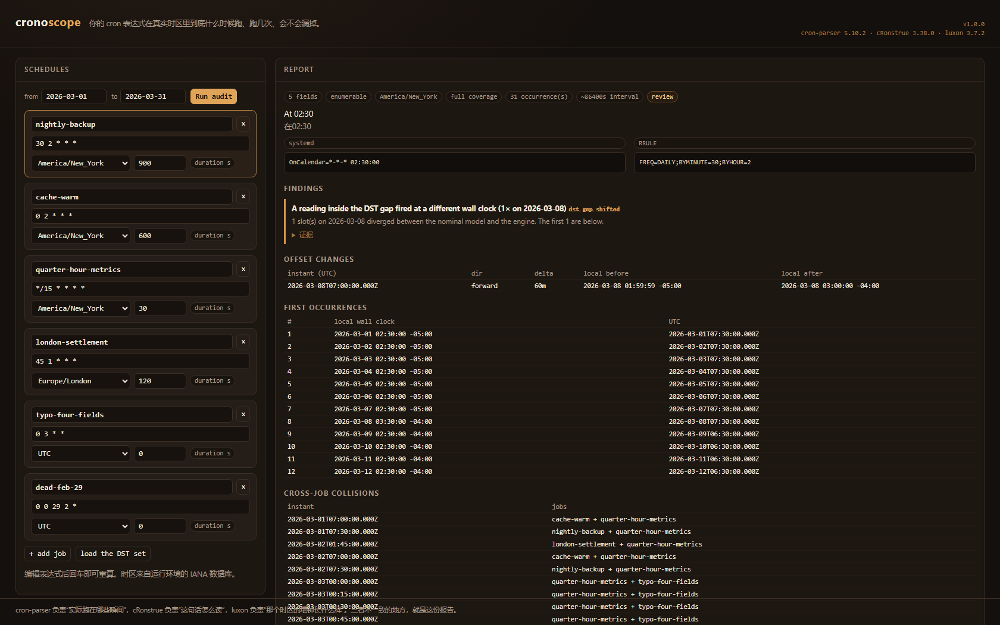
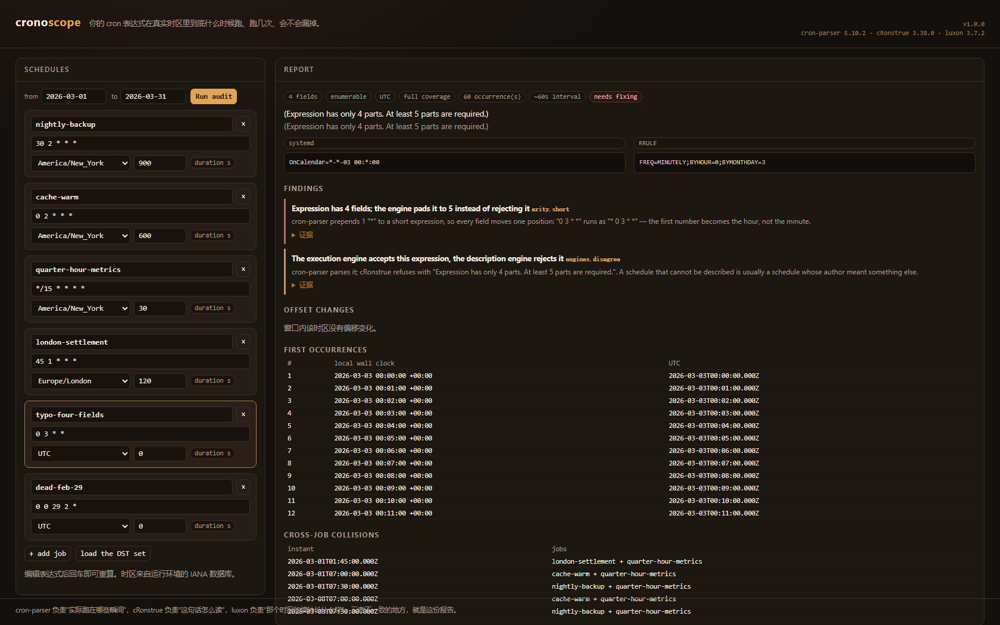
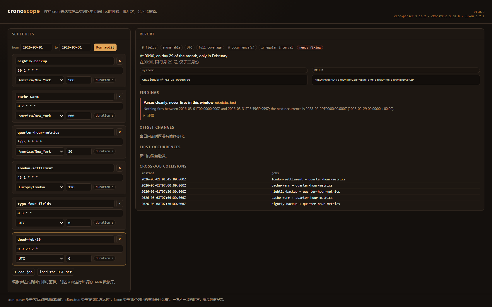

# cronoscope

**Audit cron schedules against the wall clock they actually run on.**

You wrote `30 2 * * *`. On 8 March 2026 the job fires at 03:30. On 1 November it
fires once although the reading happens twice. On a 30-minute-DST island it
fires 48 hours apart. None of that is visible in the crontab, and none of it is
visible in a "next 5 runs" preview either — that preview is computed by the same
engine that has the quirk.

cronoscope builds three independent views of every schedule and diffs them:

| view | built by | answers |
|---|---|---|
| intent | this repo's field model | which wall-clock readings did you write down? |
| oracle | [cron-parser](https://github.com/harrisiirak/cron-parser) 5.10.2 | which instants actually fire? |
| language | [cRonstrue](https://github.com/bradymholt/cRonstrue) 3.38.0 | what does it say it does? |

[ luxon 3.7.2 ](https://github.com/moment/luxon) supplies the IANA time zone
database and the wall-clock arithmetic. Every finding is a divergence between
two of those views and carries the instants that prove it.

```
! nightly-backup  [America/New_York]  30 2 * * *
   At 02:30   ·   在02:30
   31 occurrence(s), typical interval 86400s, nominal demand ~31
   [ WARN] dst.gap.shifted: A reading inside the DST gap fired at a different
           wall clock (1× on 2026-03-08)
           evidence: reading "2026-03-08 02:30:00" → fired "2026-03-08 03:30:00 -04:00",
           deltaMinutes 60
```

```
✗ typo-four-fields  [UTC]  0 3 * *
   (no description: Expression has only 4 parts. At least 5 parts are required.)
   [ERROR] arity.short: Expression has 4 fields; the engine pads it to 5
           instead of rejecting it
           "0 3 * *" runs as "* 0 3 * *" — the first number becomes the hour.
```



*Screenshots are captured from the running page by `npm run docs:images` and
measured numerically (size, distinct colours, luminance spread per band) by
`test/images.test.js` — a blank or half-rendered frame fails the build. They are
not retouched.*

| the padded 4-field expression | a schedule that never fires |
|---|---|
|  |  |

---

## 中文速览

`cronoscope` 把每条 cron 拆成三种独立视图再互相比对：**你写下的墙钟读数**（本仓库自己的字段模型）、**真正会触发的瞬间**（cron-parser）、**别人读到的意思**（cRonstrue 中英双语），时区由 luxon 提供。

它报告的不是"我觉得这条表达式有问题"，而是三种视图对不上的具体位置：DST 空洞里被推迟到 03:30 的定点任务、被整体跳过的网格任务、只跑一次的重复读数、少写一段导致引擎左补 `*` 的表达式、以及一条永远不触发的死调度。每条结论都带证据（读数、实际触发瞬间、偏移差）。

命令行退出码可以直接进 CI：`0` 干净、`3` 有达到阈值的问题。

---

## Quickstart

```bash
npm ci                 # or npm install
npm test               # 138 assertions
node scripts/bench.mjs # the measurements quoted in docs/FINDINGS.md

node bin/cronoscope.js explain '30 2 * * *' --tz America/New_York
node bin/cronoscope.js audit examples/jobs.json --from 2026-03-01 --to 2026-03-31 \
     --format text
```

Browser demo (no build step needed — `demo/bundle.js` is committed):

```bash
npx serve .    # then open /demo/ — or any static server from the repo root
```

`npm run verify` regenerates the licence files, runs the suite, rebuilds the
bundle and drives the real page in headless Chrome/Edge.

## What it finds

| code | severity | what happened |
|---|---|---|
| `arity.short` | error | fewer than 5 fields; the engine left-pads with `*` and every field shifts |
| `engines.disagree` | warn | one engine accepts the expression, the other refuses it |
| `schedule.dead` | error | parses cleanly, never fires in the window (next real occurrence is named) |
| `slot.missing` | error | a reading whose instant exists never fired |
| `dst.gap.shifted` | warn | a reading inside a forward transition fired at another wall clock |
| `dst.gap.skipped` | warn | a reading inside a forward transition fired nowhere |
| `dst.ambiguous.single` | warn | a reading that happens twice fired once |
| `occurrence.unexpected` | note | an instant fired with no matching reading |
| `cadence.gap` | warn | an interval beyond 1.5× the measured median |
| `cadence.sla_breach` | error | an interval beyond the job's declared `slaMaxGapSeconds` |
| `coverage.truncated` / `coverage.sampled` | warn / note | the budget forced a bounded view (reason printed) |
| `expression.nondeterministic` | note | `H` — the reading cannot be recovered from the text |

Findings are aggregated per code per day: a dense job can produce hundreds of
identical divergences, and a report that repeats itself is a report nobody reads.

## CLI

```
cronoscope audit  <jobs.json> [--from --to --tz --format --out --fail-on
                              --max-occurrences --mode --threshold]
cronoscope explain <expression> [--tz --lang en|zh_CN|both]
cronoscope next    <expression> [--tz --count]
cronoscope convert <expression> [--tz]      # systemd + RRULE + iCalendar
cronoscope job     <expression> [--tz --from --to --sla]   # JSON for one job
```

Exit codes: `0` clean · `2` usage · `3` findings at/above `--fail-on` · `4`
internal failure.

`--format text|md|json|csv|ics`, and `--out` writes to a file. The JSON report is
`schemaVersion: 1`, with `meta`, `jobs[]`, `conflicts`, `summary`.

### Jobs file

```json
{
  "jobs": [
    { "name": "nightly-backup", "expression": "30 2 * * *",
      "tz": "America/New_York", "durationSeconds": 900, "slaMaxGapSeconds": 180000 }
  ]
}
```

`durationSeconds` is a declared duration, used only for overlap maths. Jobs
without one still participate in exact-instant collisions and are never given an
invented length.

## Collisions

Two crontab lines that fire at 02:00 look innocent next to each other. The tool
reports both exact-instant collisions (same absolute instant, across zones) and,
when durations are declared, merged overlap windows with peak concurrency. A
sweep line over half-open intervals means back-to-back jobs do not count as
overlapping.

## Design

The short version: three views, a slot-by-slot diff, and refusals instead of
approximations when translating to systemd or RFC 5545. See
[`docs/ARCHITECTURE.md`](docs/ARCHITECTURE.md).

Two decisions worth knowing about:

* **An independent field parser** (~250 lines) duplicates work cron-parser
  already does. That duplication is the point: it is what lets the tool say "the
  engine read your text differently" instead of agreeing with itself.
* **Coverage budgeting.** A year of `* * * * *` is ~80 s of engine time
  (measured). Above the occurrence budget, the audit looks where DST can break a
  schedule — around offset changes — plus one baseline day, and says so.

## What the upstreams actually do

`docs/FINDINGS.md` records the measured behaviour of all three libraries,
including the parts their READMEs do not mention: the left-padding of short
expressions, the three different ways a DST gap is handled depending on the
expression's shape, cRonstrue throwing strings, and the `W` / `L-n` syntax one
engine describes and the other rejects.

## Tested environment

* Node **v22.22.2**, Windows 11, npm 10.9.7 — the numbers above come from this
  machine.
* `npm test` → **138 assertions in 12 files**, all passing. They pin the DST
  behaviour per zone (`America/New_York`, `Europe/London`, `Australia/Lord_Howe`,
  `Asia/Shanghai`, `Pacific/Chatham`, `UTC`), the field model, both description
  locales, the CLI exit codes, all four exports and the licence obligations.
* `node scripts/verify-demo.mjs` → headless Chrome drives three deep-linked
  states of the real page and asserts on the produced DOM (18 checks, including
  a measured `deltaMinutes` and `2028-02-29` that only appear if the audit ran
  in the browser). The full log is in [`docs/VERIFICATION.md`](docs/VERIFICATION.md).
* `npm run docs:images` → the three README screenshots, captured from those same
  deep links and decoded by `scripts/png-stats.mjs` (a small PNG reader in this
  repo) to measure size, distinct colours and per-band luminance spread.
* Not verified: human visual review. This machine's image-reading tool cannot
  accept an image, so the screenshots are checked numerically, not by eye — see
  [`docs/LIMITS.md`](docs/LIMITS.md).

## Licence and provenance

MIT. `cronoscope` is **not a fork**: it composes three MIT libraries as pinned
dependencies and bundles them unmodified for the browser. Their notices travel
with the code:

* `third_party/<package>/LICENSE` — verbatim texts, hashed in
  `third_party/INDEX.json`
* [`THIRD_PARTY_NOTICES.md`](THIRD_PARTY_NOTICES.md) — regenerated from those
  files by `npm run licenses`
* [`NOTICE`](NOTICE) — precise scope of the original work vs. the dependencies

A test fails if a runtime dependency is missing a licence copy, if a hash drifts,
or if a development-only tool leaks into the shipped notices.

## Limits, honestly

Sampled jobs do not see gaps outside their sampled spans; the year field and
`W` are reported but not modelled; `H` is opaque by design; floating-time iCal is
a trade-off, not a guarantee. All of it, including what "not verified" means
here, is in [`docs/LIMITS.md`](docs/LIMITS.md).
